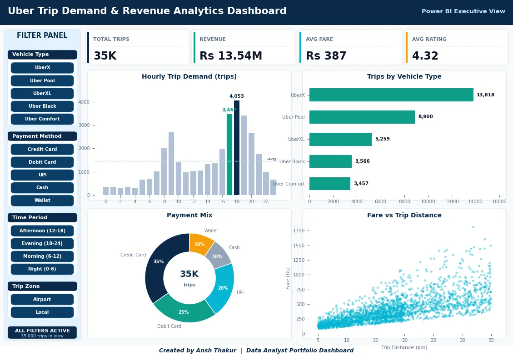
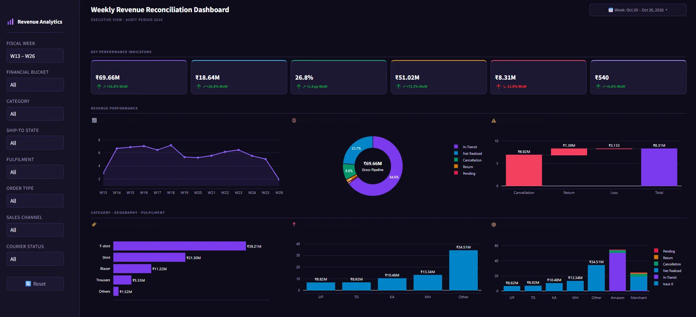

# 👨‍💻 Ansh Thakur — Portfolio

### Junior / Associate Data Scientist · Applied AI Engineer · Data Analyst
#### Python · SQL · Power BI · FastAPI · SARIMA · LangChain · scikit-learn · Docker

  
  
  
  
  
  
  
  

---

  
  
  
  

---

## 🎯 Flagship Engineering & Data Science Projects (Featured on Resume)

### 1. 🚖 [Forecast Guard: AI-Powered Ride Demand Forecasting & Operations](https://gitlab.com/ansht_121/data-analytics/-/tree/main/01_ride-demand-and-revenue-forecasting)
> **Nov 2025 – Dec 2025** · *Python, SQL, statsmodels (SARIMA), FastAPI, Groq LLM, Hugging Face Spaces, Docker*

* **35,000+ Ride Records Analyzed:** Isolated that the evening rush window (5–7 PM) holds **31.2% of daily demand**, while airport journeys contribute **54.8% of total revenue** from only 39.6% of trips.
* **14-Day SARIMA Statistical Forecaster:** Developed a production demand forecasting engine achieving **8.3% MAPE** (~20% improvement over baseline moving-average models).
* **Dynamic Surge-Pricing Simulator:** Simulated demand-elastic multipliers projecting **+53% gross-margin uplift** during peak evening windows, served directly via a high-performance **FastAPI microservice endpoint**.
* **Confidence-Gated GenAI Operations Copilot:** Deployed on Hugging Face Spaces where the SARIMA 95% confidence band gates an LLM (Groq) writing daily operations briefs—preventing hallucinations by triggering AI strictly on statistically confirmed demand anomalies.

---

### 2. ⚡ [E-Commerce Revenue Reconciliation & Leakage Audit Engine](https://gitlab.com/ansht_121/data-analytics/-/tree/main/10_ecommerce-reconciliation-engine)
> **May 2026 – Jun 2026** · *Python, SQL, Isolation Forest, Gradient Boosting, LangChain (RAG), ChromaDB, Streamlit, Excel, pytest, GitLab CI*

* **128,976 Amazon Orders Audited (₹7.86 Cr Gross GMV):** Engineered an 11-step cleaning and financial reconciliation pipeline classifying every order into 6 financial buckets (*Net Realized, In-Transit, Pending, Cancellation, Return, Loss*) across 14 fiscal weeks.
* **Forensic Revenue Leakage Separation:** Separated true operational revenue loss (**₹83.07 Lakhs**, 83.3% driven by 18,334 order cancellations) from **₹5.10 Crore capital actively in transit**, replacing an erroneous 23.7% gross-coverage metric with boardroom-accurate figures.
* **Dual Financial Cockpits:** Delivered a formula-driven Microsoft Excel dashboard (6-KPI wall with 5 dropdown slicers) alongside an interactive Streamlit application with an ML risk radar and one-click dispute ticket generator.
* **ML Anomaly & Policy RAG Copilot:** Deployed an Isolation Forest detecting **2,215 irregular settlement records** plus a Gradient-Boosting leakage classifier reaching **0.9235 ROC-AUC**, paired with a ChromaDB RAG copilot that automatically drafts Amazon Seller Support claims citing the exact applicable policy clauses.
* **CI/CD Quality Guard:** Enforced through **10 passing pytest tests** with seed-fixed reproducibility, Ruff linting, Makefile automation, and GitLab CI on every commit.

---

## 📈 Portfolio Projects at a Glance

| Project | Domain | Primary Stack | Key Benchmark / Headline Result |
| :--- | :--- | :--- | :--- |
| 🚖 **Forecast Guard** *(Flagship 1)* | Time-Series & GenAI | Python, SARIMA, FastAPI, Groq LLM | **8.3% MAPE** · +53% Surge Margin Uplift · 35K records |
| ⚡ **E-Commerce Reconciliation** *(Flagship 2)* | Forensic Audit & ML | Python, Isolation Forest, RAG, Streamlit | **₹7.86 Cr Audited** · 0.9235 ROC-AUC · 10/10 Tests Passed |
| 📊 **Subscription Retention Analytics** | Churn Mitigation | Python, Scikit-learn, Power BI, SQL | **0.84 ROC-AUC** · 7,043 Customers · Tenure Risk Mapped |
| 📦 **Supply Chain Logistics Intelligence** | Operational BI | Power BI (DAX), SQL, Excel Modeling | **11.4% Freight Savings** · 7,991 Orders · 47 SKUs |
| 🛡️ **Pipeline Contract Guard Agent** | Data Quality CI/CD | Python, pytest, GitLab CI/CD, Docker | **Zero Schema Drift** · 16 Contract Fields · Pre-commit Gate |

---

## 🛠️ Core Technical Competencies

| Category | Skills & Tools | Methodologies |
| :--- | :--- | :--- |
| **Languages & DBs** | Python (Pandas, NumPy, Scikit-learn, pytest), SQL (MySQL, PostgreSQL) | Advanced CTEs, Window Functions (`LAG`, `RANK`, running sums), Joins |
| **Machine Learning & Stats** | SARIMA, Isolation Forest, Gradient Boosting, Logistic Regression, ANOVA | Time-Series Forecasting, Anomaly Detection, Hypothesis Testing, ROC-AUC, MAPE |
| **Generative AI** | LangChain, ChromaDB, Groq LLM API, Prompt Engineering | Policy RAG Copilots, Strict JSON Outputs, Confidence-Gated Generation |
| **BI & Deployment** | Power BI (DAX), Advanced Excel, Streamlit, FastAPI, Docker, GitLab CI/CD | Executive KPI Cockpits, Microservice Serving, Containerized Deployments |

---

## 💼 Verified Work Experience

#### **Data Science & AI Trainee** — *Digital Edify Pvt. Ltd., Hyderabad, India*
*Jun 2025 – Nov 2025*
* Built and validated predictive ML and NLP models using Python and Scikit-learn after thorough exploratory analysis.
* Queried MySQL and PostgreSQL databases using advanced joins, CTEs, and window functions to extract key business metrics.
* Gained practical exposure across the modern AI stack, covering statistics, data processing, and Generative AI fundamentals.

#### **Data Analytics Intern** — *Unified Mentor Pvt. Ltd., Remote*
*Sep 2025 – Dec 2025*
* Extracted, cleaned, and validated 5,000+ complex raw data records using SQL and Excel to ensure absolute data integrity.
* Built interactive Power BI dashboards to track critical weekly performance KPIs and key business trends.
* Automated recurring reports using advanced DAX measures and Power Query, reducing manual reporting effort by 30%.

---

## 🎓 Education & Certifications

* **Master of Computer Applications (MCA)** — *Ballarpur Institute of Technology, Gondwana University* (Final Year — Expected 2027)
* **B.Sc. in Information Technology** — *Sardar Patel Mahavidyalaya, Gondwana University* (CGPA: 7.26/10, Jul 2022 – May 2025)
* **BCG X GenAI Job Simulation** — Forage (Certificate completed Jun 2025)
* **TATA GenAI Data Analytics Simulation** — Forage (Certificate completed Jul 2025)
* **British Airways Data Science Simulation** — Forage (Certificate completed Aug 2025)

---

## 📬 Contact & Collaboration

