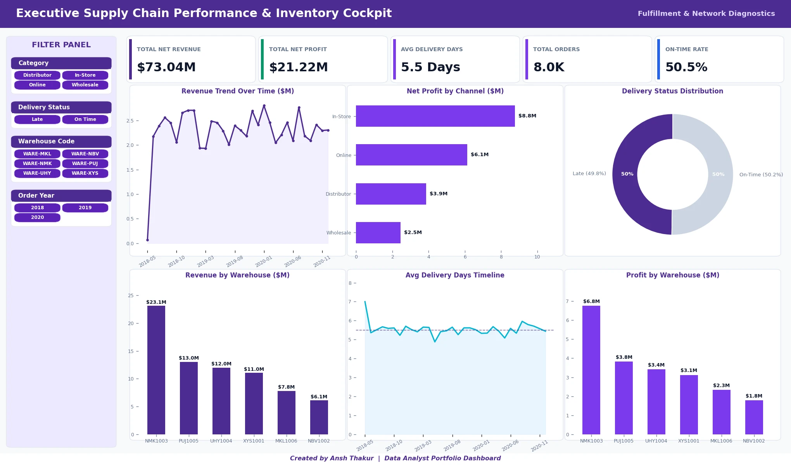
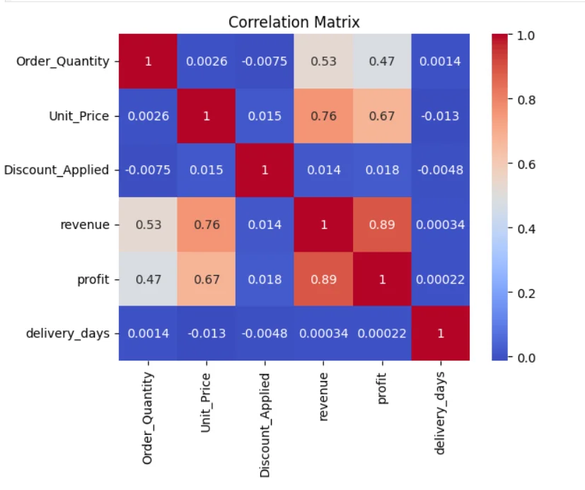
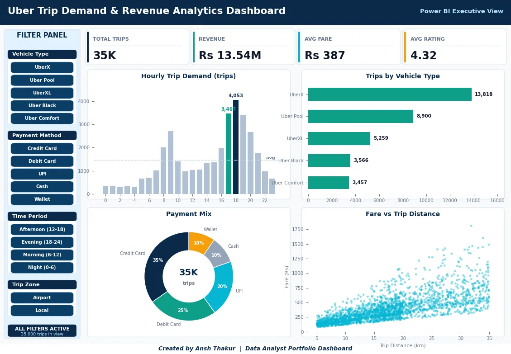
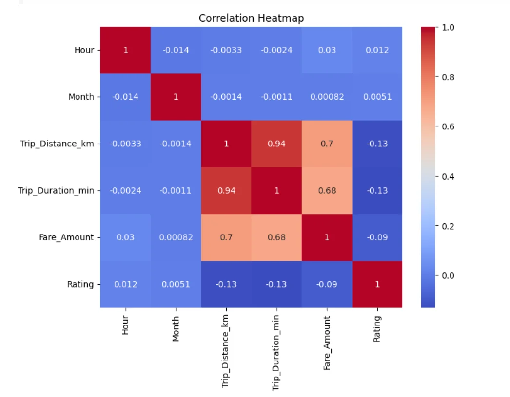
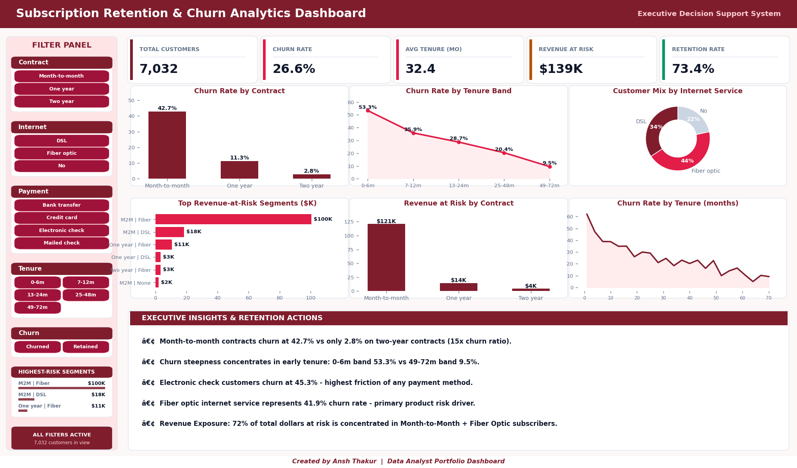

<div align="center">

# 👨‍💻 Ansh Thakur — Portfolio

### Data Analyst & Machine Learning Practitioner · Python · SQL · Power BI · scikit-learn · TensorFlow

<p align="center">
  
  
  
  
  
  
  
</p>

---

<p align="center">
  <a href="https://gitlab.com/ansht_121"></a>
  <a href="https://ansh-thakur-netlify.netlify.app/"></a>
  <a href="https://www.linkedin.com/in/ansh-thakur-5407192b4/"></a>
  <a href="mailto:ansht1194@gmail.com"></a>
</p>

<p align="center">
  <a href="https://gitlab.com/ansht_121/data-analytics"></a>
  <a href="https://gitlab.com/ansht_121/Data-Science-Project"></a>
</p>

</div>

---

**I answer business questions with data — including the ones where the answer is "don't do it."**

B.Sc. IT graduate and Data Analytics Intern who turns raw data into reproducible, business-actionable insight — and, increasingly, into predictive models. My public work spans **9 end-to-end projects** across data analytics and data science / machine learning, with every headline figure traceable to committed code.

As an **entry-level Data Analyst** with a growing **machine learning** toolkit, I specialize in translating complex datasets into clean, reliable, and actionable business insights. I work **AI-first with human validation**: AI co-pilots the repetitive work — code drafting, documentation, dashboard scaffolding — while every generated output is run, debugged, and verified against the raw data before it reaches a stakeholder.

---

## 📈 Portfolio at a Glance

| Domain | What's Inside | Headline |
| :--- | :--- | :--- |
| 📊 [**Data Analytics**](https://gitlab.com/ansht_121/data-analytics) | 3 end-to-end projects · 50,034 records · SQL + Python + Power BI | Revenue stall root-caused: **flat revenue, −4.09% profit** — it's *price*, not demand (0.08% between-warehouse variance) |
| 🤖 [**Data Science & ML**](https://gitlab.com/ansht_121/Data-Science-Project) | 6 projects · scikit-learn + TensorFlow + NLP | CNN digit recognition at **98.83%** test accuracy |

---

## 🛠️ Core Skills & Tools

| Category | Technologies & Libraries | Key Methodologies |
| :--- | :--- | :--- |
| **Languages** | Python, SQL (MySQL), JavaScript, Java, HTML/CSS | Exploratory Data Analysis, Statistical Analysis |
| **Data & ML Libraries** | Pandas, NumPy, scikit-learn, TensorFlow/Keras, NLTK, Matplotlib, Seaborn | Data Cleaning, Feature Engineering, Model Training |
| **Machine Learning** | CNNs, Linear/Logistic Regression, Random Forest, TF-IDF NLP, recommenders | Classification, Regression, NLP, Model Evaluation |
| **BI & Visualization** | Power BI (DAX), Advanced Microsoft Excel (VBA, Power Query, Pivots) | Interactive Dashboards, Executive KPI Reporting |
| **AI-Assisted Analytics** | AI pair-programming, prompt engineering, AI-assisted EDA & documentation | Co-Pilot Workflows, Human Validation Gates, Data Storytelling |
| **SQL Techniques** | CTEs, `LAG()`, `RANK()`, `ROW_NUMBER()`, running `SUM() OVER`, `STDDEV_SAMP` | Variance Decomposition, Pareto Analysis, Trend Detection |
| **Development** | Google Colab, Jupyter, VS Code, Git & GitLab, React, Node/Express, Spring Boot | Reproducible Analysis, REST APIs, Automation Scripting |

---

## 🤝 How I Work in the AI Era

The four skills that keep an analyst relevant as AI handles more of the execution:

| Pillar | What It Means in Practice |
| :--- | :--- |
| **System design over syntax** | End-to-end pipeline thinking — raw data → cleaning → SQL warehouse → BI layer — designed for reproducibility and scale. AI drafts code; architecture stays a human decision. |
| **AI as co-pilot, not competitor** | Prompt engineering and AI-assisted workflows accelerate cleaning, query drafting, and docs. Every AI output is run, debugged, and validated against source data — hallucinated SQL doesn't ship. |
| **Business understanding** | Every skill is applied against a business question: what decision does this analysis drive? Three of my case studies returned "don't act" — the answer that saves budget. |
| **Communication & storytelling** | Insights ship as stakeholder-ready narratives — headline first, caveats where they matter, dashboards a non-technical reader can navigate solo. |

---

## 🎯 Business Questions I Answered

If an interviewer asks one of these, the query and the number are already in my [Data Analytics repository](https://gitlab.com/ansht_121/data-analytics).

| Business Question | Finding | Decision It Drives |
|:--|:--|:--|
| **Sales have been flat for the last 6 months — why?** | **Revenue is flat, not down — but profit fell 4.09%.** Net revenue **+0.50%** (₹1.41 cr) while profit dropped **₹1.69 lakh** and margin fell **134 bps** (29.44% → 28.10%). Orders **+4.94%**, units **+4.84%** — demand *grew*. The gap is **price**: ASP fell **4.14%**, and splitting it shows **−3.97 pp is gross price**, only **−0.18 pp** is discount. | **Don't launch a demand campaign** — it treats a symptom that doesn't exist. Fix price realisation: review Distributor (−4.17 pp margin) and Online (−1.67 pp) first |
| **Are we exposed to losing one big customer? Should we build a key-account programme?** | **No — there is no key account to protect.** The largest of 50 customers is **2.75%** of net revenue, the top 5 are **12.35%**, and the Herfindahl index of **203** implies **49.3 effective customers of 50**. The top store of 367 is **0.6%**. | **Declined to build a key-account programme** and put the effort into pricing, where the money actually leaks. Concentration analysis exists to *rule risks out*, not just find them |
| **Which sales team is actually costing us margin — pricing or discounting?** | **A 5.03 pp margin spread across 28 teams, and it is a discount-behaviour gap.** Best team **31.55%** margin at 11.11% average discount vs worst team **26.52%** at 11.63%. Margin correlates **−0.638** with average discount but only **+0.103** with ASP, and order counts are near-equal (1.4×) — so it is not a mix effect. | **Gated discount approvals for the bottom-5 teams** (9, 18, 1, 2, 12) instead of a generic sales incentive. Bringing them to the median margin adds **₹2,45,957 (1.16% of total profit)** |
| **Is the evening revenue peak a real surge-pricing effect, or just more trips?** | **A genuine price premium — and it survives the control.** Peak hours earn **₹26.25/km vs ₹19.39/km** (+6.86). Airport share is near-identical in peak vs quiet hours (**39.96% vs 39.61%**), and on non-airport trips alone the premium is **₹27.23 vs ₹20.02** — **105% of the headline effect survives** the confounder check. | **Recommended pricing the peak window explicitly** (~35% per km currently captured implicitly) instead of assuming the volume peak is the whole story |
| **Is churn a price problem — do customers leave because they pay more?** | **No — and the relationship is not even monotonic.** Churn by monthly-charge quartile is **11.32% → 24.59% → 37.55% → 32.88%**. The *most expensive* quartile churns **4.67 pp less** than the third. | **Rejected blanket discounting to retain customers** — it would have added cost without saving revenue. Redirected to contract structure and onboarding |
| **Is paperless billing a real churn driver, or just a proxy for contract type and payment method?** | **Real — it survives a triple control.** Uncontrolled, paperless churns **33.59% vs 16.38%**, but it is also over-represented on month-to-month plans and electronic-check accounts. Holding contract, *tenure and payment method* constant at once, paperless still churns worse in **31 of 38 cells** (mean lift **+8.30 pp**; month-to-month / 0–12 mo / electronic check: **67.8% vs 50.2%**). The effect holds *within* every single payment method. | **Reframed paperless billing as a product defect to fix** — first-payment failures, card expiry, refund friction — not a segment to target. A cheap fix the churn-rate table would have hidden |
| Is deep discounting the real cause — and was late delivery to blame? | **Discounting is a real but partial cause; delivery is not.** Revenue in the 20%+ band grew **13.03% → 16.79%** of net revenue; reverting the mix would have held margin at **28.62%** instead of 28.10% — the shift alone cost **52 bps ≈ ₹73,617**. Meanwhile on-time delivery went **49.4% → 52.3% → 48.5%** and late-revenue exposure stayed flat at ~50%. | Set a **product-level profit floor**, not a blanket discount cap (the 5–10% band is healthy at ~33% margin). Keep delivery on a **separate workstream** |
| Half our orders are late — which warehouse is at fault? | **None.** Only **0.08%** of delivery-time variance is between warehouses; all six have 2.82–2.88 day spread. | Fix upstream scheduling, not a facility — a per-site project would fix nothing |
| Isn't our biggest warehouse the worst offender? | **No — a volume illusion.** It causes 31.9% of late orders but handles 31.4% of all orders. | Always normalise counts by volume before ranking anything |
| Are discounts eating our margin? Should we cap them? | **Yes — at high levels.** Orders at 20%+ discount return only **4.64%** margin versus 31.02% in the 5–10% band, with 373 orders unprofitable. | Set product-level profit floors and review the 20%+ discount band |
| When should a ride-hailing firm surge-price? | **5–7 PM carries 31.2% of demand** in 3 of 24 hours — and the surge *starts* at 5 PM, not 6 PM when volume peaks. | Launch driver incentives by 4:30 PM, an hour ahead of peak |
| Do higher-rated drivers earn more per trip? | **No, and the obvious read is backwards.** Low-rated drivers show higher fares — but only because they drive longer trips. Fare-per-km is flat at ₹22.06–22.41. | Investigate long-trip rider experience; don't penalise drivers |
| Can we focus on just our top revenue zones? | **No.** It takes **4 of 5 zones** to reach 80% of revenue. | Keep coverage city-wide — the 80/20 assumption fails here |

**Fourteen of these; eight say "don't act."** Knowing where *not* to spend is the part that saves budget.

---

## 📊 Featured Data Analytics Projects

### 1. 📦 [Supply Chain Performance Analysis](https://gitlab.com/ansht_121/data-analytics/-/tree/main/supply-chain-performance-analysis)





*An end-to-end operational analytics project featuring a Python data cleaning pipeline, custom SQL metrics, and an automated, fully interactive 10-chart Excel dashboard.*

* **Business Challenge:** Half of all orders miss the 5-day delivery target, with ₹3.63 cr of net revenue exposed — and leadership needs to know whether to invest in a specific warehouse or the network.
* **Tech Stack:** Python (Pandas, openpyxl), SQL (MySQL — CTEs, `STDDEV`, `LAG`, window functions), Statistical Variance Decomposition (ANOVA principles), Microsoft Excel (VBA, Macros, Pivot Tables).
* **Key Achievements:**
  * **Disproved the obvious answer.** Ranking warehouses by late-order count blames the largest site; variance decomposition shows only **0.08%** of delivery-time variance is between warehouses. Prevented a misdirected improvement programme.
  * **Root-caused a revenue stall.** A volume/price/mix decomposition showed revenue is **flat (+0.50%)**, not down, while profit fell **4.09%** — orders grew **4.94%** but ASP fell **4.14%**. A SKU-level reconciliation proved **price**, not volume or assortment, caused the plateau, and a discount-band counterfactual priced the mix shift at **52 bps ≈ ₹73,617**.
  * **Ruled out a risk that wasn't there.** Revenue concentration analysis (Herfindahl index **203** → **49.3 effective customers of 50**) proved no key-account programme was needed, and showed the **5.03 pp** sales-team margin spread is a **discount-behaviour** gap (margin correlates **−0.638** with discount, only **+0.103** with ASP), not a pricing-ability gap.
  * Cleaned and processed raw transactional data, generating dynamic metrics like **Delivery Days**, **Order-to-Ship Days**, and **Profit Margins** (₹7.30 cr net revenue / ₹2.12 cr profit across 7,991 orders).
  * Implemented an automated Excel workbook generator using `openpyxl` with dynamic dropdown selectors, date-range inputs, and custom formula-driven pivot tables.
  * Used **ABC Classification** to segment the 47-SKU catalogue by net-revenue contribution (A-items = 80.6% of net revenue) — with an honest read that this catalogue shows only moderate, not textbook 80/20, concentration.
  * Shipped a reproducible Python pipeline so every quoted figure regenerates from the raw data.

### 2. 🚖 [Uber Trip Demand Analysis](https://gitlab.com/ansht_121/data-analytics/-/tree/main/uber-trip-demand-analysis)





*A comprehensive revenue and behavioral analysis of ride-sharing transactions using SQL data warehousing, Python visualization, and Excel dashboarding.*

* **Business Challenge:** Identifying when to surge-price, where to position premium vehicles, and which fleet tier to grow across 35,000 trips.
* **Tech Stack:** MySQL (window functions, CTEs, `LAG`, running totals), Python (Seaborn, Matplotlib), Advanced Excel, Power BI.
* **Key Achievements:**
  * Used `LAG()` to separate peak *volume* from peak *growth* — demand accelerates at **5 PM (+138%)**, an hour before the 6 PM volume peak, moving the incentive trigger an hour earlier.
  * Caught a confounded metric: lower-rated drivers appear to earn more, but the effect vanishes once trip distance is controlled for (**fare-per-km flat at ₹22.06–22.41**).
  * Quantified that **airport trips are 39.6% of volume but 54.8% of revenue** (₹535.77 vs ₹289.40 avg fare).
  * **Proved the evening peak is a real price premium, not a mix artefact.** Peak hours earn **₹26.25/km vs ₹19.39/km**; with airport trips removed the premium is *larger* (**₹27.23 vs ₹20.02**) — **105% survives** the confounder check — so the ~35% per-km peak premium is being captured only implicitly.
  * Built a MySQL schema over 35,000 records with `ROW_NUMBER()` deduplication and null validation.
  * Conducted vehicle-category analysis measuring revenue per ride and revenue-to-distance efficiency (Uber Black ₹40.06/km vs Uber Pool ₹14.08/km).
  * Reported three **negative findings** (no weekend fare effect, no seasonality, no zone concentration) that removed unjustified recommendations, and showed driver concentration is a non-risk (HHI **100.3** → **99.7 effective drivers**).

### 3. 📊 [Subscription Retention Analytics](https://gitlab.com/ansht_121/data-analytics/-/tree/main/subscription-retention-analytics)



*End-to-end churn risk and revenue-at-risk analysis on 7,032 customers, delivered through a custom Python pipeline, SQL cohort analysis, and an interactive Excel dashboard.*

* **Business Challenge:** A subscription business is losing ~26% of customers. Which customers leave, when, why, and what revenue is exposed — so retention spend can be prioritised by dollars saved, not by gut feel.
* **Tech Stack:** Python (Pandas, Seaborn, openpyxl), SQL (MySQL — `LAG`, `RANK`, `STDDEV_SAMP`, CTEs), Microsoft Excel (native charts, filterable table), Jupyter.
* **Key Achievements:**
  * Identified **Month-to-month contracts churn at 42.7%** versus near-zero on two-year plans (chi-square = 1179.5, Cramér's V 0.41) and quantified that **month-to-month + fiber-optic = 72% of revenue at risk**.
  * **Killed a false price story and proved a real billing driver.** Churn by charge quartile is **non-monotonic** (11.32% → 24.59% → 37.55% → 32.88%) — the most expensive quartile churns *less* — while paperless billing survives a contract × tenure × payment-method triple control (worse in **31 of 38 cells**, mean lift **+8.30 pp**). Priced a 1 pp churn reduction at **$4,557/month**.
  * Built a 5-KPI, 6-chart executive Excel dashboard with a left-side Filters panel matching the supply-chain reference style — native, filterable, formula-driven from the ChartData sheet.
  * Caught a confounder: fiber-optic customers churn more, but a large part of the effect is the contract mix, not the service itself — the dashboard splits the two.
  * **Corrected three claims with stronger evidence.** Seniors are *not* immaterial (41.68% vs 23.65%, surviving contract and paperless controls), partner/dependents effects survive the contract control (dependents churn *less*: 15.53% vs 31.28%), and paperless billing *is* an independent driver — it survives a contract × tenure × payment-method triple control (31 of 38 cells, +8.30 pp). The old "negative findings" were under-tested; the new analysis tests each against its confounders.

---

## 🤖 Data Science & ML Projects

Six end-to-end projects in my [Data Science & ML repository](https://gitlab.com/ansht_121/Data-Science-Project) — each structured as a proper package with modular `src/`, `tests/`, and `params.yaml`, not just a loose notebook.

| # | Project | Type | Approach | Result |
| :-- | :--- | :--- | :--- | :--- |
| 1 | Handwritten Digit Recognition | Image classification | CNN (TensorFlow/Keras), MNIST | **98.83%** test accuracy |
| 2 | Spam Email Detection | Binary NLP | TF-IDF + Logistic Regression | **96.32%** test accuracy |
| 3 | Sales Prediction | Regression | Linear Regression | **R² = 0.91** |
| 4 | Car Price Prediction | Regression | Random Forest Regressor | MAE · MSE · R² |
| 5 | Tweet Sentiment Analysis | Multi-class NLP | TF-IDF (n-grams) + balanced LogReg | **71%** acc · 0.70 F1 |
| 6 | Music Recommendation | Recommender | Content-based, cosine similarity | Top-K similar tracks |

> Model complexity is matched to the problem — Linear Regression where the relationship is linear, Random Forest where it is not — and limitations (like the sentiment model's minority-class recall) are reported honestly.

---

## 💼 Experience

**Data Analytics Intern** — *Unified Mentor Pvt. Ltd.* (Sep 2025 – Dec 2025)

- Performed data cleaning, transformation, and validation on large datasets using Python (Pandas) and Excel
- Built automated reporting workflows and KPI dashboards for business stakeholders
- Applied SQL for data extraction, joins, subqueries, and window functions
- Developed Power BI dashboards with DAX measures for executive reporting
- Collaborated with cross-functional teams to gather requirements and document analytical processes

---

## 🎓 Education

**Bachelor of Science in Information Technology (B.Sc. IT)**
*Sardar Patel Mahavidyalaya, Chandrapur — Gondwana University, Maharashtra*
**CGPA: 7.26/10** · 2022 – 2025

---

## 🧾 Certifications

- **Tata GenAI Powered Data Analytics Job Simulation** — Forage ([Verify](https://www.theforage.com/completion-certificates/ifobHAoMjQs9s6bKS/gMTdCXwDdLYoXZ3wG_ifobHAoMjQs9s6bKS_Pn2fgx9uC9r33pJRp_1752581188250_completion_certificate.pdf))
- **Deloitte Data Analytics Job Simulation** — Forage ([Verify](https://www.theforage.com/completion-certificates/9PBTqmSxAf6zZTseP/io9DzWKe3PTsiS6GG_9PBTqmSxAf6zZTseP_Pn2fgx9uC9r33pJRp_1750857267981_completion_certificate.pdf))
- **British Airways Data Science Job Simulation** — Forage ([Verify](https://forage-uploads-prod.s3.amazonaws.com/completion-certificates/tMjbs76F526fF5v3G/NjynCWzGSaWXQCxSX_tMjbs76F526fF5v3G_Pn2fgx9uC9r33pJRp_1754161186122_completion_certificate.pdf))

---

## 📄 Resume

[Download Resume (PDF)](Analyst_Resume.pdf)

---

## 📂 Repository Structure

```bash
ansh-thakur-portfolio/
│
├── images/                     # Dashboard screenshots (PNG + WebP pairs)
├── index.html                  # Portfolio website source (self-contained CSS + JS)
├── Analyst_Resume.pdf          # Downloadable resume
└── README.md                   # This portfolio
```

---

## 📬 Contact & Collaboration

I am actively seeking entry-level **Data Analyst**, **Business Intelligence Analyst**, or **Data Engineer** roles where I can help teams turn complex data into clean, business-boosting decisions.

<div align="center">

[](https://gitlab.com/ansht_121)
[](https://ansh-thakur-netlify.netlify.app/)
[](https://www.linkedin.com/in/ansh-thakur-5407192b4/)
[](mailto:ansht1194@gmail.com)

</div>

Feel free to browse my code, download the interactive Excel dashboards to explore their dynamic filters, or connect with me on LinkedIn!
